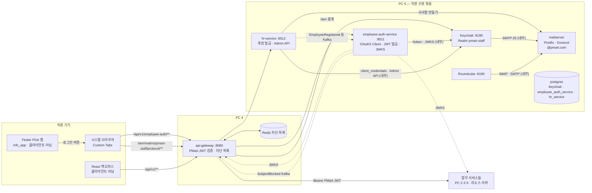
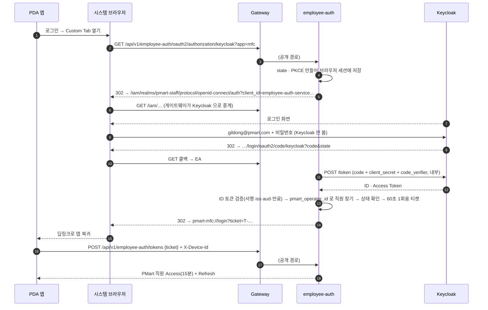
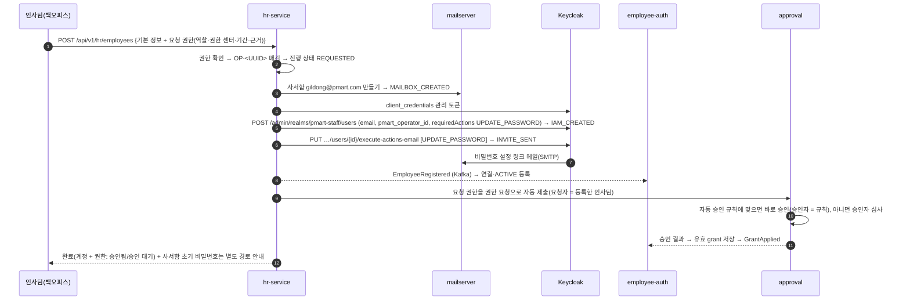

# 직원 인증 전체 구조 — Keycloak(신원) + Employee Auth Service(PMart 직원 JWT) + HR Service(계정 발급) + 사내 메일

- 작성: 2026-11-12. **상태: 결정됨, 구현 전** — [ADR-0056](../../adr/0056-staff-login-employee-auth-service-and-hr-service.md)(2026-11-12 승인)이 ADR-0054 의 직원 부분(결정 L·M, 직원 토큰 발급자, 백오피스 Keycloak 직접 로그인)을 대체한다. D1~D9 모두 정함(§13).
- 기준 설계(강의): [`references/2026-11-12/pmart-keycloak-guide.html`](references/2026-11-12/pmart-keycloak-guide.html) — 강의 설계를 PMart 에 맞춘 적용안. 사내 메일: [`references/2026-11-12/baropick_mail_iam_guide.html`](references/2026-11-12/baropick_mail_iam_guide.html).
- 이 문서가 정한 것: 사용자 결정 2026-11-12 — ① 메일 도메인 `@pmart.com` ② 배치는 Claude 가 정함(§4) ③ 비밀값은 PMart 방식(`.secrets` 원본 + pmart-config `{cipher}`) ④ 이 설계를 따른다. 나머지 값(포트·경로·사건 이름·표 이름)은 **제안**이고 §13 의 결정이 남아 있다.
- 지금 구조(비교 대상): [`keycloak-structure.md`](keycloak-structure.md), [`login-structure-and-flow.md`](login-structure-and-flow.md), [`issuer-table.md`](issuer-table.md), ADR-0054·0055.

## 진행

- **2026-11-12 §12 2단계 완료(LAN)**: PC 5 `mailserver`(docker-mailserver 16.0.1)·`roundcube`(1.7.6, `https://192.168.0.101:8190`, ADR-0057 사설 CA). Keycloak `pmart-staff` SMTP = `mailserver:25`·`no-reply@pmart.com`. 확인: Keycloak `execute-actions-email` → `claude-dev@pmart.com` 사서함 도착, Roundcube 로그인(IMAP STARTTLS 를 루트 CA 로 확인), 외부 주소 반송(`5.7.1 … stays inside pmart.com`). 시험 사서함 `claude-dev@pmart.com`(비밀번호 `.secrets/mail-claude-dev-password`), Keycloak `claude-dev` 의 email 도 이 주소로. 결정 9 의 "자체 서명"은 ADR-0057 사설 CA 로 바뀜, "Docker 네트워크만 허용"은 `PERMIT_DOCKER=connected-networks`(Keycloak HELO 가 FQDN 이 아님).
- **2026-11-12 D10 정함**: 사용자 "일단 otp 안넣을거야" — 백오피스 OTP 넣지 않음(Keycloak 로그인 클라이언트 하나).
- **2026-11-12 §12 3단계 구현**: `services/employee-auth-service`, 계약 `contracts/openapi/employee-auth-service.yaml`. 통합 시험은 **실제 Keycloak 26.8.1 컨테이너**로 로그인 화면 → 비밀번호 → 콜백 → 티켓 → 토큰까지(`EmployeeLoginIT`). 발급자 표에 `staff-ea` 줄 추가(Keycloak `staff` 줄과 함께), 게이트웨이 `/api/v1/employee-auth/**`. 구현하면서 정한 것(설계 §7·§8 의 제안을 바꾼 곳):
  - **Spring OAuth2 Client 를 쓰지 않고** 인가 코드 흐름을 직접 구현(state·nonce·PKCE S256, ID 토큰 서명·iss·aud·azp·만료·nonce 검증). 이유: 게이트웨이가 모든 요청의 `Cookie` 헤더를 지워(`RemoveRequestHeader=Cookie`) 세션 쿠키에 기대는 기본 흐름이 게이트웨이 뒤에서 돌지 않고, 공통 보안 체인(무상태 JWT)을 그대로 쓸 수 있다. 로그인 시도(state 해시·nonce·verifier)는 DB `login_attempt` 에 10분.
  - 경로: 시작 `GET /api/v1/employee-auth/logins?app=&deviceId=&codeChallenge=`, 콜백(Keycloak redirect URI) `GET /api/v1/employee-auth/logins/callback`.
  - **티켓은 앱이 만든 code_challenge 에 묶는다**(앱 쪽 PKCE): 시작 때 앱이 `codeChallenge = BASE64URL(SHA-256(verifier))` 를 주고, 티켓 교환 때 `codeVerifier` + 같은 `X-Device-Id` 가 맞아야 한다. 쿠키 없이 시작한 쪽과 받는 쪽을 묶고, 딥링크를 가로챈 다른 앱은 티켓을 못 쓴다(RFC 8252 §8.1). 틀린 시도도 티켓을 태운다.
  - **Keycloak 세션은 콜백에서 코드 교환 직후 바로 끝낸다**(Keycloak refresh token 으로 logout) + 로그인 시작에 `prompt=login` — D8 ① 을 로그아웃 때가 아니라 로그인 때 처리(Keycloak 토큰을 저장하지 않아도 됨). 직원 세션은 PMart 세션 하나.
  - 세션 = min(갱신 + 앱 무활동 한도, 시작 + 12시간): `mfc` 30분(D8 ③), `backoffice` 12시간. 갱신 때 직원 상태·역할을 다시 읽는다. 복귀 주소 = 설정 `pmart.employee-auth.apps.<app>.return-uris`(LAN 백오피스 `http://192.168.0.40/auth/callback` 등 — 클라이언트 요청은 6단계).
  - 직원 데이터(`employee_account`: 상태·역할·센터, D1 정본)는 hr-service·approval 연동(5단계) 전까지 **관리 경로** `PUT /api/v1/employee-auth/employees/{operatorId}`(OPERATOR_ADMIN, 역할 목록 검사, 자기 계정 변경 금지, 변경 기록)로 넣는다. ACTIVE 가 아니게 바꾸면 세션을 끝낸다 — 이미 나간 access token 즉시 차단(`SubjectBlocked`)은 5단계(그 전까지 최대 15분).
  - 첫 로그인 연결: Keycloak `sub` 로 찾고, 없으면 ID 토큰의 `pmart_operator_id`(클라이언트 매퍼 — ID 토큰에만) 로 `employee_account` 를 찾아 연결. 다른 Keycloak 사용자가 이미 연결된 운영자 ID 면 거절.
  - LAN 시험 교환(D5): `POST /api/v1/internal/dev-token-exchange` — Keycloak access token(azp = `pmart-dev-cli`)을 본문으로, `pmart.employee-auth.dev-token-exchange.enabled=true` 일 때만 경로가 있다.
  - 아직 없는 것(5단계): Kafka(Employee* 구독, `SubjectBlocked`·`GrantApplied` 발행), grant·대행·행위 시점 검증 API, 근무 시작일·계약 종료일 확인.
- **2026-11-12 백오피스 SSO(사용자 결정 — D8 을 백오피스에서 바꿈)**: 사용자 "백오피스는 sso적용하는게 나은것같아". 앱별 설정 `sso` — **backoffice 만 켬**, PDA(mfc)는 지금처럼 매번 비밀번호. 켠 앱은 Keycloak 세션을 남기고(`prompt=login` 없음) 새 탭은 비밀번호 없이 로그인된다. Keycloak 세션 무활동 한도 = **Realm 값 12시간 그대로**(사용자 선택 — 공용 PC 에서 브라우저를 닫지 않으면 그 동안 다음 사람이 들어올 수 있음을 알고 고름). 로그아웃은 **Keycloak 세션도 끝냄**(사용자 선택): 로그아웃 응답 `idpLogoutUri` 로 브라우저 이동 → Keycloak end_session(`id_token_hint` — SSO 세션에만 Keycloak ID 토큰 저장, 클라이언트 기본 범위 `basic` 만이라 이름·이메일 없음, 만료돼도 동작 확인) → `<출처>/login`. 백오피스 저장소는 sessionStorage 그대로(클라이언트 결정 D1 수용). 클라이언트 요청 `docs/handoff/clients/archive/2026-11-12-clients-request-backoffice-sso-logout.md`.
- **2026-11-13 5단계 시작 — 5-1 hr-service 구현(미배치)**: 계약 `hr-service.yaml`·`mail-provisioner.yaml`, 사건 `Employee*.v1.json`(토픽 `platform.employee.v1`), 흐름 `docs/business/flows/employee-account-provisioning.md`. 구현에서 정한 것: 계정 발급은 등록 응답 뒤 작업기가 단계별로(사서함이 메일을 받는지 SMTP 로 확인한 뒤 Keycloak·안내 메일), 정지·퇴사의 Keycloak·사서함 반영도 재시도 작업기(즉시 차단은 사건 쪽), 사서함 초기 비밀번호는 별도 발급 응답에만(멱등 기록에도 남기지 않음), 본인 조회 `GET /hr/employees/me`. **U-11 확인: `manage-users` 만으로 Realm 역할 매핑이 된다(204)** → (B) 역할 매핑 API 를 부르지 않고 (A) hr-service 배포 전에 발급자 표 Keycloak 줄을 뺀다. `hr-provisioner` 는 `fullScopeAllowed: false` 라 `clientScopeMappings` 로 realm-management 역할을 줘야 한다. 5-2 mail-provisioner 구현(같은 날, `platform-services/mail-provisioner` — 계정 파일 한 줄·SHA512-CRYPT·비활성 `!`·SMTP RCPT 확인, LAN 포트 없음·root·mail-config 볼륨, 미배치). 5-3 employee-auth-service 사건 구독 구현(같은 날 — 등록 → ACTIVE·Keycloak 연결·근무 시작일, 정지·퇴사 → 세션 종료·`SubjectBlocked`, 복귀, `hr_version` 으로 늦은 사건 무시, 관리 경로 정지도 `SubjectBlocked`). 다음: 5-5 이전·배치.
- **2026-11-13 Keycloak 발급자 줄 뺌(U-11 (A), 사용자 "그 줄 빼고 5-4 시작")**: pmart-config `0af0756`. LAN 반영은 앱 재시작 때(5-5, hr-service 배포 전 — 자동 권한 검사가 전체 재시작을 막아 미룸).
- **2026-11-13 5-4 권한 요청 연동 구현(미배치)**: 제출 경로를 내부 API 대신 사건 `GrantRequested`(hr-service outbox, platform.employee.v1)로 정했다 — 등록 완료와 같은 트랜잭션이라 hr-service 에 재시도 장치가 필요 없다. approval-service: type `GRANT`(계약에 이미 있음), 자동 승인 규칙 표(설정 저장소, 승인자 `RULE:<id>@v<버전>`), 맞는 행·나머지 행은 승인을 나눔(부분 승인 없음), 수동 심사 `OPERATOR_ADMIN`. employee-auth-service: `employee_grant`(V4), 토큰 역할·센터 = 계정 값 ∪ 유효 grant(`EmployeeAccess`), `GrantApplied`(platform.auth.v1)·반영 회신. hr-service: 요청 권한 SUBMITTED → APPROVED·REJECTED. 흐름 `employee-account-provisioning.md` §3.
- **2026-11-13 5-5 LAN 배치(`306f8c8`, pmart-config `7f15c7d`)**: Keycloak `hr-provisioner`(사용자 조회 200·역할 조회 403 확인)·로그아웃 허용 주소 :8081/:5174, **앱 37개 재시작으로 Keycloak 발급자 줄 제거 반영**(Keycloak 토큰은 게이트웨이·PC 마다 서비스에서 401, 직원 토큰은 통과), approval-service(PC 4)·employee-auth-service·mail-provisioner·hr-service(PC 5) 배포(커넥터 `outbox-hr-service` 자동 등록, 31개 RUNNING). 기존 13명 이전: Keycloak 이메일 `<아이디>@pmart.com`(아이디는 그대로), 사서함 12개 새로(비밀번호는 무작위·미보관 — 인사팀이 다시 발급), 인사 기록 P2026-00001~00013(고용 형태 REGULAR·소속(센터 속성 하나면 그 센터, 아니면 본사 `HQ`)·시작일 11-11 은 **자리값**). E2E 17/17(사용자 허락 뒤). 인사 담당 heeji(HR_ADMIN).
- **2026-11-13 7단계 일부(LAN)**: Keycloak 업무 역할 11개·사용자 연결·`centers`(속성·프로필·매퍼)·중계 클라이언트 `pmart-auth-relay` 삭제(백업 `docs/operations/2026-11-13-keycloak-legacy-roles-backup.json`), auth-service 중계 끔, Realm 가져오기 파일 맞춤. 로그인·SSO·직원 토큰 역할 그대로 확인. `pmart-backoffice` 클라이언트도 삭제(같은 날, 사용자 "응"). 남은 7단계: auth-service 운영자 로그인(OPERATOR)·`operator_account`·꺼진 `StaffBlockRelay` 코드 — 사용자 결정.
- **2026-11-12 4단계 완료(LAN)**: 클라이언트 배포 회신(백오피스 employee-auth-service 로그인 LAN 배포·실로그인 확인, pmart-clients `08c7032`) 뒤. Keycloak `KC_HOSTNAME=https://192.168.0.40:8443/iam`(+ `KC_HOSTNAME_ADMIN` 직접 8180·backchannel dynamic·xforwarded — 별도 Keycloak 26.8.1 로 관리 API·관리 콘솔이 직접 주소로 되는지 먼저 시험), 발급자 표 staff 줄 iss, `employee-auth-service` keycloak.issuer·콜백 `https://192.168.0.40:8443/api/v1/employee-auth/logins/callback`(Keycloak 클라이언트도 https 만), 앱 37개 재시작(설정만 바뀜 — 주소 표는 그대로). LAN 확인: 백오피스 SSO(첫 로그인 비밀번호 → 새 탭 바로 → 로그아웃 → Keycloak 로그아웃 → 다시 비밀번호)·PDA 흐름이 **게이트웨이 HTTPS `/iam` 을 거쳐** 성공(루트 CA 로 검증), 업무 API 200, Keycloak 시험 토큰(새 iss)·시험 교환 동작, 위조 401. §6 표의 `KC_HOSTNAME_BACKCHANNEL_DYNAMIC` 은 그대로 맞았고 관리 주소(`KC_HOSTNAME_ADMIN`)를 더했다. 남은 것: 5단계(hr-service·mail-provisioner), 7단계 정리(Keycloak 줄·`pmart-backoffice`·`pmart-auth-relay`·auth-service 운영자 로그인).
- **2026-11-12 4단계 준비(안 끊기는 부분)**: LAN 백오피스가 아직 Keycloak 에 직접 로그인하므로 Keycloak 주소(`KC_HOSTNAME`)는 백오피스가 employee-auth 로그인으로 옮긴 뒤 바꾼다(클라이언트 요청 `docs/handoff/clients/archive/2026-11-12-clients-request-backoffice-employee-auth-login.md`). 먼저 한 것: 게이트웨이 `/iam` 중계(로그인 경로만, **Keycloak 쿠키는 넘김** — 게이트웨이의 Cookie 제거를 전역 필터로 바꾸고 이 라우트만 예외), 그 밖의 `/iam/**` denyAll, 게이트웨이 HTTPS 8443(8080 과 함께). 실제 Keycloak 26.8.1 을 `KC_HOSTNAME=http://localhost:<게이트웨이>/iam`·`KC_PROXY_HEADERS=xforwarded` 로 띄워 게이트웨이 경유 로그인 → code 까지 시험(`KeycloakIamIT`) — 경로 붙은 hostname + StripPrefix 동작 확인(§6 표의 "구현 때 확인" 해소).

## 1. 한 줄 요약

**Keycloak 은 "이 직원이 맞다"만 증명하고, PMart 직원 JWT 는 Employee Auth Service 가 만든다.** 고객(Google → auth-service)·라이더(Google → rider-auth-service)와 같은 모양 — "밖에서 신원 확인 → PMart 가 토큰 발급" — 이 직원에게도 적용된다.

| | 고객 | 라이더 | 직원(이 설계) |
|---|---|---|---|
| 신원 확인 | Google | Google | **Keycloak**(Realm `pmart-staff`, 계정 `xxx@pmart.com`) |
| PMart 토큰 발급 | auth-service | rider-auth-service | **employee-auth-service**(새) |
| 신원 확인 방식 | 앱이 받은 Google ID 토큰 검증만(ADR-0055) | 같음 | **OAuth 2.0 인가 코드 흐름 — 서비스가 Keycloak 의 기밀 클라이언트** |
| 계정 만들기 | 회원가입 | 라이더 가입(rider-service) | **hr-service**(새) → Keycloak Admin API + 메일 사서함 |
| 토큰 검증 | 게이트웨이 + 각 서비스(발급자 표) | 같음 | 같음 — 발급자 표 `staff` 줄만 바뀐다 |

## 2. OAuth 역할 — 누가 무엇인가

| OAuth 역할 | 이 설계에서 |
|---|---|
| 인가 서버(Authorization Server, OIDC 제공자) | Keycloak(PC 5) |
| 클라이언트 — 로그인 | **employee-auth-service** (기밀, `authorization_code` + PKCE) — Keycloak 에 등록되는 유일한 로그인 클라이언트 |
| 클라이언트 — 관리 | **`hr-provisioner`** — hr-service 가 쓰는 서비스 계정 클라이언트(기밀, `client_credentials`, `realm-management` 의 `manage-users`·`view-users`·`query-users` 만 — §6-1) |
| 리소스 서버 | api-gateway, 모든 업무 서비스 — **PMart 직원 JWT 만** 검증. Keycloak 토큰을 보지 않는다 |
| 리소스 소유자 | 직원(MFC 작업자·본사 운영자·인사팀 …) |
| 클라이언트가 **아닌 것** | Flutter PDA 앱(mfc_app), React 백오피스 — 로그인 화면은 앱이 연 브라우저에 뜨지만, 인가 코드를 받고 토큰으로 바꾸는 쪽은 employee-auth-service. 앱에는 client_secret 도 Keycloak 토큰도 없다 |

employee-auth-service 는 **두 얼굴**이다: Keycloak 쪽에서 보면 OAuth 클라이언트, PMart 안에서 보면 JWT 발급자(개인키 서명·JWKS 공개). auth-service 가 Google 에 대해 하는 일과 같은 자리다(다만 auth-service 는 ID 토큰 검증만 하고 인가 코드 교환은 하지 않는다 — ADR-0055).

## 3. 구성요소와 책임 경계

| 구성요소 | 소유(책임) | 소유하지 않음 |
|---|---|---|
| **Keycloak** (있음) | 직원 IAM 계정(`username = email = <id>@pmart.com`), 비밀번호·잠금(5회), Keycloak 세션·SSO, 비밀번호 설정/재설정·이메일 확인 메일 발송(내장 기능, SMTP 로 메일 서버에 맡김), 사용자 속성 `pmart_operator_id` | PMart 역할·센터(§13 D1), PMart 토큰, 메일 사서함 |
| **employee-auth-service** (새) | Keycloak 로그인 연동(OAuth2 Client), Keycloak ID 토큰 검증, `Keycloak sub ↔ OP-…` 연결, 직원 로그인 상태(ACTIVE/DISABLED/LEFT), 일회용 로그인 티켓, 직원 세션·Refresh 회전, **PMart 직원 JWT 발급·JWKS**, 직원 차단 사건 발행, **직원 역할·권한 센터의 정본**(유효 grant·대행·긴급권한·행위 시점 검증 API — D1, auth-service 에서 옮김), 권한 반영 확인 `GrantApplied` 발행 | 직원 인사 정보(hr-service), 계정 만들기, 권한 요청의 심사·승인(approval) |
| **hr-service** (새) | 직원 등록·퇴사·정지의 업무 흐름, 직원 신원·고용 정보(이름·메일 ID·고용 형태·소속·근무 시작/계약 종료 — §8-1), 운영자 ID `OP-<UUID>` 매기기, **계정 발급 진행 상태**(사서함 → IAM → 안내 메일 — 부분 실패 재시도·보상), Keycloak Admin API 호출, 사서함 만들기 요청 | 로그인·토큰(employee-auth-service), **권한의 효력·저장**(등록 화면에서 받은 요청 권한은 approval 에 올릴 뿐 — 승인·자동 승인 뒤 employee-auth-service 가 저장, D1), MFC 작업 자격(mfc-capacity) |
| **mailserver** (새, docker-mailserver) | `@pmart.com` 사서함, SMTP(받기·보내기)·IMAP | 계정 정책(hr-service), 외부 인터넷 메일(하지 않는다 — §9) |
| **roundcube** (새) | 사서함을 보는 웹메일 화면(IMAP 읽기 + SMTP 보내기) | 메일 저장(메일 서버) |
| **api-gateway** (있음) | `/api/v1/employee-auth/**`·`/api/v1/hr/**` 라우팅, `/iam/**` → Keycloak OIDC 경로 중계(관리 경로 차단), PMart JWT 검증·차단 목록 | 로그인 처리 자체 |
| **auth-service** (있음) | 고객·비회원·서비스 신원 토큰만(ADR-0054 결정 2) | 직원 로그인·직원 토큰·**직원 권한(RoleGrant 등 — employee-auth-service 로 옮김, D1)**. 이전 뒤 `operator_account`·운영자 로그인·`StaffBlockRelay` 내림 |

service-map 51개 → 53개(employee-auth-service, hr-service). 메일 서버·웹메일은 인프라(placement 구성요소)로 둔다.

## 4. 배치 — 직원 신원 묶음을 PC 5 에

| 구성요소 | PC | LAN 포트 | 컨테이너 안 | DB | 메모리 상한 |
|---|---|---|---|---|---|
| keycloak (있음) | PC 5 | 8180 | 8080 · 9000(관리) | pc5 postgres `keycloak` | 1.5 GB |
| employee-auth-service | PC 5 | **8511** | 8511 | pc5 postgres `employee_auth_service` | 768 MB |
| hr-service | PC 5 | **8512** | 8512 | pc5 postgres `hr_service` | 768 MB |
| mailserver | PC 5 | **없음**(LAN 미공개) | 25 · 587 · 143 · 993 | 볼륨 `mail-data`·`mail-state`·`mail-logs`·설정 | 1 GB |
| roundcube | PC 5 | **8190** | 80 | 볼륨 `roundcube-data`(SQLite) | 256 MB |
| mail-provisioner (새, 사이드카) | PC 5 | 없음(LAN 미공개) | 내부 HTTP | 메일 서버 설정 볼륨 공유 | 256 MB |

왜 PC 5 인가:
- Keycloak 이 이미 PC 5 에 있다. Keycloak → 메일 서버(SMTP), hr-service → Keycloak(Admin API), employee-auth-service → Keycloak(`/token`·JWKS)이 **같은 Docker 네트워크 안**에서 끝나 메일 포트·관리 API 를 LAN 에 열 필요가 없다.
- PC 4 는 이미 구성요소 22개·디스크 여유 61 GB 로 가장 무겁고, 8080 은 게이트웨이가 쓴다(가이드의 Roundcube 8080 과 겹침 → 8190 으로 바꿈). PC 2 는 주문·결제와 CPU 를 나누지 않기로 RAG 를 뺀 PC, PC 3 은 MFC 개발 PC.
- 늘어나는 양 약 2.8 GB. 2026-11-12 PC 5 남은 메모리 17.1 GB(Docker VM 25 GB) — ollama(GPU)·배송 6개·개발 작업과 함께 감당 가능. 느려지면 employee-auth·hr 를 PC 4 로 옮긴다(Eureka 등록이라 주소 고정 없음).
- 위험: 직원 로그인 전부가 PC 5 하나에 달린다(지금도 Keycloak 때문에 같음). PC 5 는 2026-11-11 08:56 비정상 종료 이력이 있어 지켜본다.
- 포트: 85xx 는 인증·배송 계열(8501 auth-service … 8510 rider-auth-service) 다음 번호. 8190 은 Keycloak 8180 옆.
- `placement.conf` pc5 줄 **끝에** 붙인다(컨테이너 고정 IP 가 순서로 정해짐). mailserver·roundcube 는 LAN 포트가 없거나 actuator 가 없으므로 `watch.sh` `check()` 에 점검 방법을 같이 넣는다(SMTP 응답 `220`, Roundcube HTTP 200).

## 5. 구조도



통신 길은 두 종류다:
- **브라우저 리디렉션** — 직원이 비밀번호를 치는 Keycloak 화면은 브라우저가 닿아야 한다. 게이트웨이가 `/iam/**` 로 Keycloak 의 OIDC·로그인 화면 경로**만** 중계한다(`/iam/admin/**`, `/iam/realms/master/**` 차단).
- **서버끼리 직접** — employee-auth → Keycloak `/token`·certs, hr → Keycloak Admin API, Keycloak → 메일 서버는 PC 5 Docker 네트워크 안에서 바로. 게이트웨이를 다시 거치지 않는다.

## 6. Keycloak 설정 — 지금 → 이 설계

| 항목 | 지금(ADR-0054) | 이 설계 |
|---|---|---|
| 로그인 클라이언트 | `pmart-backoffice`(공개, PKCE) | **`employee-auth-service`**(기밀, Standard flow + PKCE, Direct access·Implicit 끔). Redirect URI `http://192.168.0.40:8080/api/v1/employee-auth/logins/callback`(3단계 구현 — Spring OAuth2 Client 경로 대신). `pmart-backoffice` 는 이전 뒤 삭제 |
| 관리 클라이언트 | `pmart-auth-relay`(관리 기록 읽기 — 차단 중계) | **`hr-provisioner`**(hr-service 용, 기밀, 서비스 계정만 — §6-1). `pmart-auth-relay` 는 "Keycloak 화면에서 직접 막는 경우"가 없어지면 삭제(§13 D6) |
| 개발 클라이언트 | `pmart-dev-cli`(직접 로그인) | Keycloak 토큰은 API 가 받지 않게 되므로 그대로는 쓸모없다 → §13 D5 |
| 토큰의 쓰임 | Keycloak Access Token 을 API 에 그대로 | Keycloak 토큰은 employee-auth-service 안에서만 쓰고 끝(앱에 내려가지 않음) |
| 역할·센터 | Realm 역할 10개 + 사용자 속성 `centers` | employee-auth-service 로(D1). Keycloak 에는 계정·비밀번호·상태·`pmart_operator_id` 만 — 이전 뒤 Realm 역할·`centers` 속성 삭제 |
| 주소(`iss`) | `KC_HOSTNAME=http://192.168.0.101:8180` | `KC_HOSTNAME=http://192.168.0.40:8080/iam`, `KC_PROXY_HEADERS=xforwarded`, 내부 호출은 `KC_HOSTNAME_BACKCHANNEL_DYNAMIC=true` — 브라우저가 본 주소와 `iss` 를 같게. **구현 때 Keycloak 26.8 에서 확인**(경로 붙은 hostname·게이트웨이 StripPrefix) |
| 메일(SMTP) | 없음 | Realm → Email: host `mailserver`, port 25, from `no-reply@pmart.com`, 인증·TLS 없음(같은 Docker 네트워크만 허용 — §9) |
| 계정 | 관리 콘솔에서 직접(결정 L) | hr-service 가 Admin API 로. 관리 콘솔은 Keycloak 관리자 전용(LAN 비노출 검토) |
| 퇴사 | 관리 콘솔에서 비활성 → 관리 기록 → auth-service 중계(결정 M) | hr-service 가 `enabled=false` + 세션 로그아웃, 사건으로 바로 차단(§7-④). **삭제하지 않는다** |

### 6-1. HR Service 의 Admin REST API 자격 (2026-11-12, `references/2026-11-12/PMart_직원_IAM_아키텍처.html` §02-3.1 반영)

세 가지가 모두 있어야 호출된다.

| # | 구성 | 내용 | 빠지면 |
|---|---|---|---|
| 1 | 서비스 계정 클라이언트 `hr-provisioner` | Realm `pmart-staff`, Client authentication ON(기밀·Secret), Service accounts ON, Standard flow·Direct access grants OFF | 관리용 토큰을 받을 주체가 없음 |
| 2 | 서비스 계정 권한 | `service-account-hr-provisioner` 에 `realm-management` 역할 `manage-users`·`view-users`·`query-users` 만. `realm-admin`·`manage-realm`·`manage-clients` 등은 주지 않음 | 토큰은 나오나 Admin API 403 |
| 3 | Client Credentials | `POST /realms/pmart-staff/protocol/openid-connect/token`(`grant_type=client_credentials`) → 관리용 토큰을 `Authorization: Bearer` 로 | 401 |

운영 규칙:
- master Realm 관리자 계정을 쓰지 않는다. `hr-provisioner` 는 employee-auth 로그인 클라이언트와 별개(같은 `/token` 이지만 grant 와 목적이 다름).
- Keycloak 내부 주소로만 호출, `/admin` 은 게이트웨이로 노출하지 않는다(§11).
- 관리용 토큰은 만료 전까지 캐시해 재사용, 401 이면 한 번 다시 받아 재시도.
- Secret 원본 `.secrets/keycloak-hr-provisioner-client-secret`, 설정은 pmart-config `{cipher}`. 교체: 새 Secret 발급 → 설정 반영·재시작 → 옛 Secret 폐기.
- Realm 관리 이벤트(Admin events) 저장을 켠다 — 감사용(누가 어떤 계정을 만들고 바꿨나). 차단 중계(D6 으로 없앰)와는 무관.
- **U-11**: `manage-users` 가 역할 매핑·그룹 가입까지 허용하는지 고정 버전(26.8.1)에서 시험으로 확인. 최종 구조에서는 Keycloak 역할이 토큰 권한이 아니므로(D1) 영향 없음. 다만 **전환 기간**(발급자 표에 Keycloak 줄이 남아 Keycloak 토큰도 받아 주는 동안 — §12 3~7단계)에는 Keycloak 역할이 실제 권한이라: (B, 기본) hr-service 는 역할·그룹 매핑 API 를 부르지 않고 시험으로 확인, (A) 가능하면 Keycloak 줄 제거를 hr-service 배포 전으로 당긴다.
- 경로·역할 이름은 고정 버전 공식 문서로 다시 확인한다.

## 7. 흐름

### ① 직원 로그인 (PDA)



- 로그인 시작(②)과 콜백(⑩)을 **같은 브라우저**가 해야 state 쿠키가 맞는다 — 그래서 앱이 아니라 브라우저가 시작 주소를 연다. 일반 WebView 금지(RFC 8252).
- 토큰을 딥링크 주소에 싣지 않는다. 주소에는 60초·1회용·발급 기기 확인 티켓만.
- 앱으로 돌아갈 주소는 설정의 허용 목록(`app=mfc` → `pmart-mfc://login`, `app=backoffice` → 백오피스 주소)에서만 고른다(열린 리디렉션 방지).
- **백오피스**도 같은 흐름: 딥링크 대신 백오피스 주소로 redirect + 티켓 교환. Keycloak 에 등록된 클라이언트는 여전히 `employee-auth-service` 하나.
- 공용 PDA 로그아웃은 Keycloak 세션도 끝낸다(`end_session_endpoint`) — 다음 작업자가 앞사람으로 자동 로그인되지 않게.

### ② 로그인 뒤 업무 API

지금 구조 그대로. 게이트웨이: 발급자 표에서 `iss` = employee-auth-service 줄 → JWKS 서명·만료 → `aud=pmart-api`·종류 `OPERATOR` 짝 → Redis 차단 목록 → 서비스. 서비스(common-security): 같은 발급자 표로 다시 검증 → `roles`·`centers` 로 업무 권한(403).

PMart 직원 JWT 모양은 **예전 auth-service 운영자 토큰과 같다**(`sub=OP-…`, `typ=OPERATOR`, `roles`, `centers`, `aud=[pmart-api]`, `sid`, `jti`, 15분). 그래서 업무 서비스의 권한 코드는 바뀌지 않고, 발급자 표 `staff` 줄의 특수 설정(`type-claim: ''`, `subject-claim: pmart_operator_id`, `roles-claim: realm_access.roles`)이 사라진다.

```yaml
# pmart-config application-lan.yml (제안)
pmart:
  security:
    issuers:
      - id: staff
        issuer-uri: 'http://employee-auth-service:8511'
        jwk-set-uri: 'http://employee-auth-service:8511/api/v1/internal/jwks'
        audiences: [pmart-api]
        user-types: [OPERATOR]
```

### ③ 신규 직원 등록 (hr-service) — 여러 시스템에 걸친 흐름



- 순서: **사서함이 메일을 받을 수 있게 된 뒤에** 안내 메일을 보낸다(메일 가이드 결론).
- 부분 실패: 단계마다 진행 상태를 hr-service DB 에 기록. 재시도는 멱등("이미 있으면 건너뛰기" — Keycloak 은 username 중복 409 를 성공으로 본다), 끝내 안 되면 보상(만든 사서함 비활성). 새 다단계 흐름이므로 구현 커밋에서 `docs/business/flows/` 에 흐름 문서를 쓴다.
- Keycloak 은 비밀번호를 평문으로 돌려주지 않는다 → 본인이 메일 링크로 정한다. 메일 본문에 비밀번호를 쓰지 않는다.
- 직원은 비밀번호가 둘이다: **IAM(Keycloak) 비밀번호**(링크로 본인이 정함)와 **사서함 비밀번호**(Roundcube 로그인용, 초기값은 인사팀이 별도 경로로 전달 → 첫 로그인 때 변경). 두 비밀번호를 맞추지 않는다.
- 사서함 만들기 방법: §9-6.

### ④ 갱신 · 로그아웃 · 퇴사/정지

- 갱신: `POST /api/v1/employee-auth/tokens/refresh` — 상태 다시 확인 후 새 쌍(1회용 회전, 해시만 저장). Keycloak 에 다시 가지 않는다.
- 로그아웃: `POST /api/v1/employee-auth/logouts` — PMart 세션 종료(+ 공용 기기는 Keycloak 세션도).
- 세션 길이: Access 15분, 세션은 근무 교대 기준(지금 Keycloak 세션 12시간과 같은 값 제안).
- 퇴사·정지: 인사팀 `POST /api/v1/hr/employees/{id}/leave`(또는 `/suspend`) → hr-service 가 Keycloak `enabled=false` + 사용자 세션 로그아웃 → `EmployeeLeft`/`EmployeeSuspended` 사건 → employee-auth-service 가 상태 LEFT/DISABLED, Refresh 전부 무효, **`SubjectBlocked`**(있는 계약 `contracts/events/SubjectBlocked.v1.json`) 발행 → 게이트웨이 Redis 차단 목록 → 이미 나간 15분 토큰도 바로 401 `SUBJECT_BLOCKED`.
- 사서함은 퇴사 때 바로 지우지 않고 비활성(보존 기간은 §13 D7).

## 8. 서비스별 데이터 · API · 사건 (제안)

**employee-auth-service** (DB `employee_auth_service`)

| 표 | 내용 |
|---|---|
| `employee_identity` | Keycloak `sub`(UUID) ↔ 운영자 ID `OP-…` (고객 auth-service `social_identity` 와 같은 역할) |
| `employee_status` | ACTIVE / DISABLED / LEFT — Keycloak 인증이 성공해도 PMart 에서 막힌 직원은 토큰을 못 받는다 |
| `login_ticket` | 해시, 60초, 1회, 발급 기기, 복귀 앱 |
| `employee_session`·`refresh_token` | 세션, Refresh 해시(회전) |

API: `GET /oauth2/authorization/keycloak`·`GET /login/oauth2/code/keycloak`(Spring OAuth2 Client 기본 경로, 공개), `POST /tokens`(티켓 교환, 공개), `POST /tokens/refresh`, `POST /logouts`, `GET /sessions/current`, `GET /internal/jwks`. 계약 `contracts/openapi/employee-auth-service.yaml`.
의존성: `spring-boot-starter-oauth2-client`(Keycloak 클라이언트), `common-jwt`(발급·JWKS), `common-security`(자기 API 보호). 상태 저장 브라우저 세션(state·PKCE)은 1대라 서버 메모리로 시작, 여러 대가 되면 Redis 세션.

**hr-service** (DB `hr_service`)

| 표 | 내용 |
|---|---|
| `employee` | `OP-…`, 사번(`P2026-00012`), 이름, 메일 ID(`@pmart.com`, 퇴사 뒤에도 다시 쓰지 않음), 고용 형태, 소속, 근무 시작일·계약 종료일, 재직 상태 |
| `provisioning` | 직원별 단계 상태(REQUESTED → MAILBOX_CREATED → IAM_CREATED → INVITE_SENT / FAILED_xxx), 시도 횟수, 마지막 오류 코드(비밀값·비밀번호 없음) |
| outbox | 사건 발행(같은 트랜잭션) |

API: `POST /hr/employees`, `GET /hr/employees`, `POST /hr/employees/{id}/affiliation-changes`(소속 변경), `POST /hr/employees/{id}/reinstatements`(재입사 — 같은 `OP-…` 다시 활성), `POST /hr/employees/{id}/leave`, `POST /hr/employees/{id}/suspend`, `POST /hr/employees/{id}/resend-invite`. 권한: 인사 역할(이름 §13 D3).
### 8-1. 직원 등록 항목과 규칙 (D4, 2026-11-12 정함)

원칙: **한 화면에서 함께 받고, 효력은 나눈다**(사용자 결정 2026-11-12 "1번을 하자"). 업무 문서 BO-01(`docs/business/BackOffice-business-logic.md`)의 입력도 "사내 신원, 소속/센터, 요청 역할·행위, 기간, 승인자·근거"를 함께 받고, "인사 연계 서비스 배치는 미결정"이라고 적는다 — hr-service 가 그 자리다. 기본 정보는 등록 즉시 효력, **요청 권한은 approval 을 거쳐야 효력**(BO-01 확정 정책 — 요청 → 심사 → 유효 grant). 인사팀이 입력했다고 권한이 바로 생기지 않는다(자동 승인 규칙에 맞는 것만 바로).

| 항목 | 필수 | 규칙 |
|---|---|---|
| 이름 | 예 | |
| 메일 ID → `<id>@pmart.com` | 예 | 로그인 ID = 사서함 주소. 중복 확인, **퇴사자 ID 재사용 금지**(감사 행위자와 섞이지 않게) |
| 고용 형태 | 예 | 정규직 / 파트타임(알바) / 일일크루 = mfc-capacity `employmentType` REGULAR·PART_TIME·DAILY 와 같은 값 |
| 소속 | 예 | 본사 부서 또는 센터(center-master 의 센터 코드). 소속일 뿐 **권한 범위가 아니다** |
| 근무 시작일 | 예 | 그 전에는 로그인 불가(employee-auth 상태 확인) |
| 계약 종료일 | 정규직 없음, 파트타임·일일크루 입력 | **종료일에 자동 정지**(hr-service 예약 처리 → `EmployeeSuspended` → 차단) |
| 사번 | 자동 | **정함(2026-11-12)**: hr-service 가 등록 때 자동으로 매김 — `P` + 등록 연도 + `-` + 5자리 순번(예: `P2026-00012`). 바뀌지 않고 다시 쓰지 않음, 재입사도 같은 번호, 고용 형태는 번호에 넣지 않음. **화면 표시·인사 검색·문의용**이고 토큰·서비스 간 식별자는 계속 `OP-…`(다른 서비스 변경 없음). 기존 13명은 이전 때 `P2026-00001` 부터 |

**요청 권한(같은 화면)**: 역할, 권한 센터, 기간(기본 = 근무 기간), 근거. 등록과 함께 approval 에 권한 요청으로 자동 제출(요청자 = 등록한 인사팀 직원). 비워 두면 권한 없이 등록(나중에 따로 요청).

**자동 승인 규칙**(사용자 결정 2026-11-12 "자동 승인은 할거야", 범위 "소속 센터 현장 역할만"): 요청 역할이 `MFC_WORKER` 이고 권한 센터가 **등록한 소속 센터와 같을 때만** 승인자 심사 없이 바로 승인한다. 기록에는 승인자 = 자동 승인 규칙(규칙 ID·버전)으로 남긴다. 그 밖(`MFC_SUPERVISOR`, 각종 `*_APPROVER`, `OPERATOR_ADMIN`, `MD`, `CS_AGENT`, 소속과 다른 센터)은 모두 승인자 심사. 규칙 표는 approval-service 설정에 두고 바꿀 때 기록을 남긴다.

받지 않는 것: MFC 작업 자격(센터 관리자가 mfc-capacity 에서), 연락처·주민번호 같은 개인정보(쓰는 곳이 없다).

규칙:
- 같은 사람이 이미 있으면 새로 만들지 않고 변경 요청(BO-01 1번). 재입사는 예전 `OP-…` 를 다시 활성(`reinstatements`).
- 센터 이동은 hr-service 에서 소속만 바꾸고, 권한은 BO-01 대로 A 종료·B 시작을 따로 요청한다.
- **일일크루도 사서함을 발급한다**(사람마다 계정 하나 — 2026-11-08 결정 Q2, 비밀번호 설정 링크를 받을 곳). 근무일 참여(enrollment)는 지금처럼 mfc-capacity.
- 직원 한 명의 순서: 인사팀이 한 화면에서 등록 + 요청 권한 → 계정(사서함 → Keycloak → 안내 메일)은 바로, 권한은 자동 승인 또는 승인자 승인 뒤 employee-auth-service 에 저장 → (MFC 작업자면) 작업 자격 지정 → 로그인. 승인 전에 로그인하면 업무 API 는 403, 화면에 "권한 승인 대기".

사건(새, `contracts/events/` + `docs/architecture/events.md`): `EmployeeRegistered`, `EmployeeSuspended`, `EmployeeReinstated`, `EmployeeLeft` — 발행 hr-service, 구독 employee-auth-service(+ 필요하면 mfc 작업자 관리). 직원 차단은 있는 `SubjectBlocked`(발행자에 employee-auth-service 추가).

## 9. 사내 메일 서버 — 가이드의 문제점과 PMart 에서 정한 것

가이드(`baropick_mail_iam_guide.html`)의 구조(docker-mailserver + Roundcube, Keycloak 내장 메일 먼저)는 그대로 따른다. 가이드가 스스로 적은 문제(15장)와 PMart 규칙에 걸리는 것을 이렇게 정한다.

| # | 가이드의 문제 | 정한 것 |
|---|---|---|
| 1 | 이미지 `latest` | 검증한 버전 **digest 고정**(Keycloak 처럼 태그만 두지 않는다). 갱신은 PR |
| 2 | 메일 포트 5개(25·465·587·143·993)를 호스트에 공개 — "공개 필요 없다"는 본문과 모순 | **메일 포트는 LAN 에 하나도 열지 않는다.** Keycloak·Roundcube·hr-service 는 같은 PC 5 Docker 네트워크 안에서 접속. LAN 에는 Roundcube 8190 만 |
| 3 | TLS 없이 STARTTLS·SMTP 인증 설정 → 실패 가능 | (a) Keycloak → 메일 서버: 포트 25, 인증·TLS 없이 **Docker 네트워크에서만 받기**(`PERMIT_DOCKER=connected-networks`) — SMTP 비밀번호 비밀값 자체가 없어진다. (b) Roundcube ↔ IMAP/SMTP: Dovecot 은 TLS 없는 평문 로그인을 막으므로 **내부용 자체 서명 인증서**(`SSL_TYPE=self-signed`, `mail.pmart.com`), Roundcube 는 내부 인증서 확인 끔. 구현 때 고정 버전 문서로 확인 |
| 4 | `ONE_DIR`·`DMS_DEBUG` 는 최신판에서 없어지거나 `LOG_LEVEL` 로 바뀜 | 쓰지 않는다. `LOG_LEVEL`. ClamAV·SpamAssassin·Fail2ban 끔(내부망·메모리) |
| 5 | 계정이 하나도 없으면 Dovecot 이 제대로 뜨지 않음 | 배포 때 `no-reply@pmart.com`(Keycloak 발신용)과 `postmaster@pmart.com` 을 먼저 만든다(`lan.sh` 배포 단계) |
| 6 | `setup email add` 는 컨테이너 안 명령 — HTTP API 가 아님, `docker.sock` 마운트는 금지 | **처음부터 자동(사용자 결정 2026-11-12 "2단계 바로")**: hr-service 와 함께 메일 서버 옆 **사서함 프로비저닝 사이드카**(`mail-provisioner`, PC 5, LAN 포트 없음)를 만든다 — 내부 HTTP(`POST /mailboxes`, `POST /mailboxes/{addr}/disable`), 서비스 토큰 인증(ADR-0011), 할 수 있는 일은 사서함 만들기·비활성화뿐, 멱등(이미 있으면 성공), 요청·결과 기록. 방식: 메일 서버의 설정 볼륨을 같이 붙여 `setup email add` 와 같은 일(계정 파일에 해시 한 줄)을 하고, 메일 서버의 변경 감지가 사서함을 만든다 — **`docker.sock` 없이**. 고정 버전에서 계정 파일 형식·해시 방식 확인. 예비 수단: 사이드카 장애 때 관리자가 `lan.sh mail-add <id>`(ssh → `docker exec … setup email add`) 후 hr-service 에서 "사서함 완료" |
| 7 | 비밀값을 `.env` 에 | `.secrets/` 원본 + pmart-config `{cipher}`(§10). `.env` 는 쓰지 않는다 |
| 8 | 발급 순서가 원본 두 개에서 다름 | 사서함 → Keycloak → 안내 메일(§7-③) |
| 9 | 볼륨 삭제(`down -v`)로 사서함 유실 | `lan.sh` 에 볼륨 삭제 명령을 두지 않는다. 메일 볼륨 백업은 DB 백업 방침과 함께 정한다(§13 D7) |

**`@pmart.com` 쓰는 것에 대해**(사용자 결정 ①): 메일 서버의 **로컬 도메인**을 `pmart.com` 으로 두면 우리 서버 안의 `@pmart.com` 끼리는 공개 DNS 없이 바로 전달된다 — 동작에 문제없다. 다만 `pmart.com` 은 우리가 소유한 인터넷 도메인이 아니므로:
- 메일 서버가 **바깥으로 보내지 않게** 한다(릴레이 호스트 없음, 외부 도메인 받는 사람 거부). 잘못 새면 실제 `pmart.com` 소유자에게 간다.
- 바깥(Gmail 등)과는 주고받을 수 없다 — 의도한 범위.
- 이름 해석이 필요하면 내부만(`mail.pmart.com` → PC 5, hosts 또는 Docker 네트워크 별칭).

## 10. 비밀값 (PMart 방식)

원본은 PC 1 `deploy/lan/.secrets/`(git 제외), 앱 설정에는 pmart-config `{cipher}` 암호문만, 컨테이너 환경변수는 `render.sh` 가 원본에서 넣는다. 로그에 남기지 않는다. `init-secrets.sh` 에 생성 단계를 추가한다.

| 새 비밀값(`.secrets/`) | 쓰는 곳 | 넣는 방식 |
|---|---|---|
| `keycloak-employee-auth-client-secret` | employee-auth-service ↔ Keycloak | pmart-config `{cipher}` + Realm 파일(render) |
| `keycloak-hr-provisioner-client-secret` | hr-service(`hr-provisioner`) ↔ Keycloak | 같음 + 교체 절차(새 Secret 발급 → 설정 반영·재시작 → 옛 Secret 폐기) |
| `employee-auth-signing-key.pem`·`employee-auth-signing-kid` | PMart 직원 JWT 서명 | pmart-config `{cipher}`(rider-auth 와 같은 방식) |
| `employee-auth-db-password`·`hr-db-password` | 각 DB | 기존 DB 비밀번호 방식 |
| `mail-postmaster-password`·`mail-noreply-password` | 기본 사서함 | render → 배포 단계 |
| `mail-tls/`(자체 서명 키·인증서) | 메일 서버 TLS | 볼륨 마운트(읽기 전용) |

SMTP 비밀번호는 §9-3(a) 로 필요 없다. 직원 사서함 초기 비밀번호는 저장하지 않는다(만들 때 한 번 전달, 본인이 변경).

## 11. 게이트웨이 변경

- 라우트: `/api/v1/employee-auth/**` → employee-auth-service, `/api/v1/hr/**` → hr-service, `/iam/**` → Keycloak(`http://192.168.0.101:8180`, StripPrefix 1, `X-Forwarded-*` 전달).
- 공개 경로(토큰 없음): 로그인 시작·콜백·`POST /tokens`·`/tokens/refresh`, `/iam/realms/pmart-staff/protocol/openid-connect/**`, `/iam/realms/pmart-staff/login-actions/**`, `/iam/resources/**`(로그인 화면 CSS·JS).
- **차단**: `/iam/admin/**`, `/iam/realms/master/**`, 그 밖의 `/iam/**`.
- 경로별 사용자 종류 허용 목록(`x-pmart-user-types`): 새 계약 경로 추가.
- 운영 전환 때 TLS 필수(비밀번호·코드·티켓이 오간다) — 지금 LAN 은 HTTP.

## 12. 지금 구조에서 옮기는 순서 (제안)

1. **ADR-0056** 작성 — ADR-0054 직원 부분 대체, 결정 L·M 대체. service-map 에 두 서비스, `docs/architecture/events.md`, `docs/business/flows/`(계정 발급 흐름).
2. 메일 서버·Roundcube 배치(PC 5) — 기본 사서함, Keycloak SMTP 설정, 비밀번호 재설정 메일이 사서함에 도착하는지 확인.
3. employee-auth-service — 계약 → 구현 → 시험(Keycloak 컨테이너로 인가 코드 흐름 통합 시험) → 배치. 발급자 표에 `staff-ea` 줄을 **추가**(옮기는 동안 Keycloak 줄과 함께 둠).
4. Keycloak 주소를 게이트웨이 `/iam` 로 — `iss` 가 바뀌므로 3 과 같은 배포 창에서, 백오피스 영향 확인.
5. hr-service + mail-provisioner — 계약 → 구현(진행 상태·재시도·보상, 역할 매핑 API 미사용 시험) → 배치. 가능하면 7단계의 발급자 표 Keycloak 줄 제거를 이보다 먼저(§6-1 U-11).
6. 클라이언트 요청(`docs/handoff/clients/`): 백오피스 로그인을 "employee-auth 시작 주소 → 티켓 교환"으로 다시 바꿈, mfc_app 로그인 새로(Custom Tabs + 딥링크 `pmart-mfc://login`), 인사팀 직원 등록 화면.
7. 전환 확인 뒤 정리 — Keycloak 줄·`pmart-backoffice`·(D6 에 따라) `pmart-auth-relay`·auth-service 운영자 로그인·`StaffBlockRelay` 내림, Realm 역할 정리(D1).

## 13. 정해야 할 것

| # | 질문 | 권장 |
|---|---|---|
| D1 | 직원 역할·센터의 정본 | **정함(2026-11-12): employee-auth-service.** auth-service 는 고객·비회원·서비스 신원만(ADR-0054 결정 2) — service-map 의 "RoleGrant·Delegation·긴급권한 정본 = auth-service" 를 옮긴다(경계 변경, ADR-0056 에 기록). 옮길 기능 코드는 없음(지금 auth-service 는 `operator_account.roles·centers` JSON 만, 대행은 빈 자리) — 운영자 13명 값만 옮긴다. hr-service 가 아닌 이유: 고용 정보와 접근 권한은 따로(BO-01 "인사상 상사라는 이유만으로 권한을 줄 수 없다"), 토큰 발급자가 갖으면 로그인 때 다른 서비스를 부르지 않는다. Keycloak Realm 역할·`centers` 는 이전 뒤 삭제 |
| D2 | 직원 ID 형식 | **정함(2026-11-12, 사용자 "알아서 만들어줘")**: `username = email = <메일 ID>@pmart.com`. 기존 운영자 13명(2026-11-12 Keycloak `pmart-staff` 기준)은 **지금 로그인 아이디를 그대로 메일 ID** 로 쓰고 운영자 ID(`OP-…`)는 그대로 연결 — `admin`, `claude-approver`, `claude-cs`, `claude-dev`, `claude-md`, `claude-mfc`, `claude-mfc-sup`, `claude-mfc-sup2`, `claude-mfc-wrk`, `heeji`, `heeji-test`, `seed-approver`, `seed-md` → 각각 `<아이디>@pmart.com`. 예약 주소(`postmaster`, `no-reply`)와 겹치지 않음. 이전 때 사서함 13개를 만들고 Keycloak `email` 을 채운다 |
| D3 | 인사 권한 역할 이름 | **정함(2026-11-12)**: `HR_ADMIN` 새 역할. 자동 승인 대상 아님 — 승인자 심사(approval) |
| D4 | 직원 등록에 받는 항목·규칙 | **정함(2026-11-12)** — §8-1: 한 화면에서 기본 정보 + 요청 권한, 권한은 approval 경유, 자동 승인 = 소속 센터 `MFC_WORKER` 만, 사번 자동(`P2026-00012`) |
| D5 | LAN 시험 스크립트(claude-dev)의 직원 토큰 받는 법 — 브라우저 흐름을 스크립트가 할 수 없음 | `pmart-dev-cli`(직접 로그인)로 Keycloak 토큰 → employee-auth-service 의 **LAN 전용**(설정으로만 켜는) 교환 경로 `POST /internal/dev-token-exchange` → PMart JWT. prod 프로필에서는 경로 자체가 없음. **정함(2026-11-12, 제안대로)** |
| D6 | Keycloak 관리 콘솔에서 직접 막는 경우를 남길지 | **정함(2026-11-12, 제안대로)**: 남기지 않음 — 모든 퇴사·정지는 hr-service 로만 → `pmart-auth-relay`·`StaffBlockRelay` 내림(ADR-0054 결정 M 대체) |
| D7 | 사서함 보존 기간·메일 백업 | **정함(2026-11-12, 제안대로)**: 퇴사 뒤 비활성으로 **계속 보존**(삭제 안 함, 실습 환경). 메일 볼륨 백업은 DB 백업 방침 정할 때 함께 |
| D8 | PDA 공용 기기 로그아웃 정책 | **정함(2026-11-12, 제안대로)** — **백오피스는 같은 날 SSO 로 바꿈**(진행 절): ① 로그아웃 때 Keycloak 세션도 종료(`end_session_endpoint`) ② 근무(교대) 종료 시각이 지나면 자동 로그아웃 ③ 무활동 30분이면 다시 로그인(2026-11-08 "30분 무활동 = 경보"와 맞춤) |
| D9 | 사서함 자동화 2단계(사이드카) 시점 | **정함(2026-11-12)**: hr-service 를 만들 때 함께 만든다(§9-6). 수동 명령은 예비 수단 |
| D10 | 백오피스 로그인 OTP(2단계 인증, LoA 2) | **정함(2026-11-12): 넣지 않는다**(사용자 "일단 otp 안넣을거야"). 아래는 검토했던 내용 — 업무 문서에는 요구 없음(참고 자료의 다른 구성안에서 온 요구). 넣는다면: Keycloak 에 employee-auth 용 클라이언트를 백오피스용·PDA용 둘로 등록해 백오피스용에만 OTP, employee-auth 가 `acr` 을 PMart JWT 에 담고, 게이트웨이가 백오피스 경로에서 `acr=2` 확인. Claude 추천: 넣는다 |

## 14. 감수하는 것

- 서비스 2개 + 인프라 2개가 늘어난다(배포·감시 대상, PC 5 부담).
- 이미 배포한 백오피스 Keycloak 직접 로그인(ADR-0054)을 다시 바꾼다.
- 로그인 결과를 앱에 넘기는 티켓 설계, Keycloak 을 게이트웨이 뒤로 숨기는 프록시·`iss` 설정을 정확히 맞춰야 한다.
- 직원이 비밀번호를 둘(IAM·사서함) 가진다.
- 얻는 것: 세 사용자 종류의 로그인 모양이 같아지고, 업무 서비스는 Keycloak 토큰 모양을 몰라도 되며(예전 운영자 토큰과 같은 모양), 앱에 Keycloak 토큰·비밀이 없고, 퇴사·정지가 인사 흐름 안에서 바로 차단으로 이어진다. 나중에 IdP 를 바꿔도 employee-auth-service 만 고친다.
