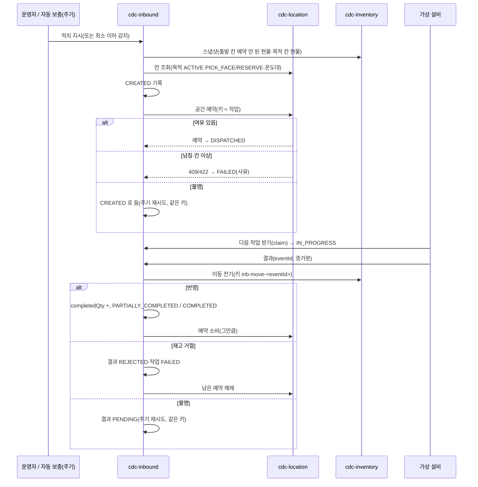

# CDC 적치·자동 보충 (사가 S7)

- 근거: WMS `docs/business/WMS-business-logic.md` CDC-F-010(적치 지시·목적지 예약)·CDC-F-011(완료·부분 완료 반영)·CDC-F-012(예외·취소)·CDC-F-013(최소 이하 자동 보충).
- 사용자 결정(2026-11-26): "입고·적치·보충", "적치 지시까지", 최소·목표 "시뮬레이터 값으로 시드", 이동 단위 "박스 입수".
- 구현: cdc-inbound 0.2.0(작업·결과·판단), cdc-location 0.7.0(공간 예약·피킹 선반 최소·목표), cdc-inventory(이동 전기 `move-postings` — 그대로). ASN·실수령·검수는 3단계.

## 참여자와 정본

| 서비스 | 정본 | 이 흐름에서 하는 일 |
|---|---|---|
| cdc-inbound | 작업(적치·보충)·설비 결과·보충 판단 | 지시·검사·예약 요청·결과 반영·재시도 |
| cdc-location | 칸·공간 예약·피킹 선반 최소·목표 | 칸 여유 검사(현물 + 미완료 예약 + 신규 ≤ maxQty) |
| cdc-inventory | 수량(현물·예약) | 이동 전기(출발 −·목적 +, 총량 그대로) |
| 가상 설비(시뮬레이터) | — | 다음 작업 받기·결과 보고(수량을 직접 바꾸지 않음) |

## 흐름

## 보상(이번 시도에서 새로 확보한 것만)
- 공간 예약이 실패하면 작업은 FAILED — 잡아 둔 것이 없으므로 풀 것도 없다.
- 설비 FAILED·재고 거절·운영자 취소: **남은** 공간 예약만 해제(키 `inb-release-<작업>`). 이미 옮긴(반영된) 수량은 되돌리지 않는다(CDC-F-013 "이미 완료한 8을 전체 취소로 원복하지 않는다").
- 취소는 반영 중인 결과가 없을 때만(409 RESULT_IN_FLIGHT) — 취소 요청만으로 운반 중 물건이 돌아온 것으로 보지 않는다. 취소 뒤 오는 결과는 받지 않는다(409 NOT_CLAIMED).

## 자동 보충 계산(CDC-F-013)
- 대상: cdc-location 에 최소·목표가 **둘 다** 설정된 ACTIVE 피킹 선반. 없는 칸은 보충하지 않는다(설정 대기 — 0·무제한으로 대신하지 않음).
- 지금 정상 현물 > 최소 → 하지 않음(ABOVE_MIN).
- 필요량 = max(0, 목표 − 지금 정상 현물 − 진행 중 보충), 지시량 = 입수 × floor(min(필요량, 출발 가능량, 칸 여유) / 입수).
  - 입수 = 상품 물류 규격 unitsPerBox(미등록이면 UNIT_MISSING).
  - 출발 = 같은 SKU 의 보관 랙(RESERVE) 칸 하나, 소비기한 이른 LOT 먼저, 예약 안 된 정상 현물 − 진행 중 작업 몫.
  - 칸 여유 = maxQty − 칸 현물 − 그 칸 진행 중 작업.
- 0 이면 작업을 만들지 않고 사유를 남긴다(`GET /cdcs/{cdcId}/replenishment-checks`): SOURCE_SHORT·ROOM_SHORT·BELOW_UNIT·OPEN_TASK_COVERS·NO_SKU.
- 수동 보충 생성은 없다(문서 "초기 제공하지 않는다").

## 아직(다음)
- 적치 후보 자동 산출(cdc-location putaway-candidates — 지금은 운영자가 목적 칸을 준다).
- 출발 점유(예약과 별개로 출발 칸 실물을 잡아 두기) — 지금은 출발 가능량 계산에서 진행 중 작업 몫을 뺀다. 그 사이 할당이 출발 칸을 잡으면 이동 전기가 거절되고 작업이 FAILED 가 된다.
- 사건 발행(PutawayTaskStateChanged·ReplenishmentMoveCreated) — 구독자가 생기면.
- 최소·목표 시드 값 — CDC 시뮬레이터 세션이 사용자께 규칙(예: 목표 = 칸 용량, 최소 = 30%)을 확인 중.
